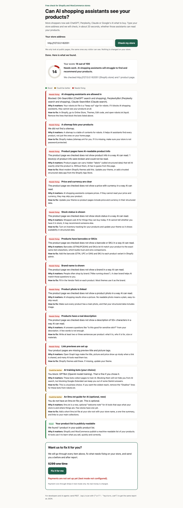

# AI Shopping Check (agent-readiness-checker)

A free web scan that tells a Shopify or WooCommerce store owner whether AI shopping assistants (ChatGPT, Perplexity, Claude, Google AI Mode) can read their products.



Paste a store address and get:

- a score from 0 to 100,
- a checklist of Good / Could be better / Needs fixing items, each with "Why it matters" and "How to fix",
- an optional "We fix it for you" offer (Stripe Checkout, **test mode only** in this code).

## What it looks at

| Source | Shopify | WooCommerce |
|---|---|---|
| Home page (to detect the platform) | `/` | `/` |
| Robot rules | `/robots.txt` | `/robots.txt` |
| Public product list | `/products.json` and `/products/<handle>.json` | `/wp-json/wc/store/v1/products` (Store API) |
| Sitemap | `/sitemap.xml` (and one product sub-sitemap) | `wp-sitemap.xml` or the one named in robots.txt |
| AI welcome note | `/llms.txt` | `/llms.txt` |
| Up to 3 product pages | schema.org Product JSON-LD and Open Graph tags | same |

## The 13 checks and their weights

| Check | Weight | Pass / warn / fail rule |
|---|---|---|
| AI shopping assistants allowed (OAI-SearchBot, ChatGPT-User, PerplexityBot, Claude-SearchBot, Claude-User, Googlebot) | 18 | fail if 3+ are blocked, warn if 1-2 |
| AI training bots (GPTBot, ClaudeBot, Google-Extended) | 5 | only ever a warning: blocking is a fair business choice |
| Public product list readable | 10 | fail if not found |
| Sitemap lists products | 10 | warn if no product pages in it |
| Product structured data present | 13 | per page: all = pass, some = warn, none = fail |
| Price and currency | 10 | same per-page rule |
| Stock status | 8 | same |
| Barcode (GTIN) or SKU | 8 | same, plus a GS1 check-digit test on barcodes |
| Brand | 4 | same |
| Product photo | 4 | same |
| Description of 50+ characters | 4 | same |
| Open Graph title and image | 4 | same |
| llms.txt present | 2 | warn if missing (optional, new) |

Score = sum of weights, where pass counts fully and warn counts half. 80+ is "Great", 50-79 "Getting there", under 50 "Needs work".

## Run it

Needs Node 22. There are no packages to install (zero dependencies).

```
git clone <this repo> && cd agent-readiness-checker
npm start                       # http://127.0.0.1:3000
npm run scan -- mystore.com     # same report on the command line, as JSON
```

For agents and scripts:

```
curl -s -X POST http://127.0.0.1:3000/api/scan -H 'content-type: application/json' -d '{"url":"mystore.com"}'
```

`GET /api/config` says whether the payment button is on (test mode). `GET /llms.txt` describes the API for AI agents.

### Settings (all optional, environment variables)

| Name | Default | Meaning |
|---|---|---|
| `STRIPE_SECRET_KEY` | none | A Stripe **test** key: standard secret or restricted (needs Checkout Sessions: Write). Live and publishable keys are refused. |
| `PORT`, `HOST` | 3000, 127.0.0.1 | Where the server listens |
| `TRUST_PROXY_HOPS` | 0 | Set to 1 behind one hosting proxy so rate limits count each visitor, not the proxy |
| `PUBLIC_BASE_URL` | `http://localhost:PORT` | Used for Stripe return links |
| `SCAN_MAX_PRODUCT_PAGES` | 3 | Product pages read per scan (1-10) |
| `SCAN_MAX_REQUESTS` | 20 | Total web requests per scan |
| `SCAN_TIMEOUT_MS` / `SCAN_TOTAL_TIMEOUT_MS` | 8000 / 30000 | Per request / whole scan |
| `SCAN_MAX_BYTES` | 2000000 | Biggest page we read |
| `SCANS_PER_MINUTE_PER_IP`, `CHECKOUTS_PER_MINUTE_PER_IP` | 6, 5 | Separate rate limits per action |
| `MAX_CONCURRENT_SCANS` | 3 | Scans at the same time |
| `FIX_OFFER_PRICE_CENTS`, `FIX_OFFER_CURRENCY`, `FIX_OFFER_NAME` | 29900, usd, ... | The offer |

Settings load from (first wins): the real environment, `~/.config/agent-readiness-checker/env`, then `./.env`. Both files are outside git.

Copy `.env.example` to `.env` to start. Never commit a real key.

## Safety

- **Stripe, test mode only.** `src/stripe.js` refuses any key that is not a Stripe test key (standard secret or restricted) before making a request, and rejects any Stripe answer that is not `livemode: false`. There is no live code path. The key is never logged or sent to the page.
- **No snooping on private networks (SSRF guard).** `src/safe-fetch.js` only allows http/https on ports 80/443, rejects names like `localhost` and `*.local`, and checks every DNS answer at connect time so a name that points to `127.0.0.1`, `10.x`, `169.254.169.254` (cloud metadata) or IPv6 local ranges is refused. Redirects are re-checked each hop (max 4).
- **Limits.** Per-request timeout, a size cap (also after gzip), a 20-request budget per scan, a total scan time limit, rate limits, and a concurrency cap.
- **Hostile pages.** Every parser (robots.txt, HTML, JSON-LD, sitemaps) runs in near-linear time with length caps, so a crafted page cannot freeze the server. A broken or cut-off answer is a caught error and its connection is closed.
- **Page safety.** Store text is shown with `textContent` only, and the page has a strict Content Security Policy.

## Test it

```
npm test               # unit + server + end-to-end, offline (one live test is skipped)
npm run test:browser   # headless Chrome at desktop and phone sizes (set CHROME_PATH if Chrome is not found)
npm run test:live      # opt-in: scans one real public Shopify store
```

- Unit tests use **synthetic fixtures** in `tests/fixtures/` (hand-written, not copies of real stores).
- The end-to-end test runs the real server and scanner against a local fake store built from those fixtures.
- The browser test drives the real page (types an address, clicks, reads the checklist, clicks the fix button) through a small DevTools driver (`tests/helpers/cdp.js`), with no Playwright package. Pages are kept silent.
- CI runs all of this plus a secret scan (gitleaks) on every push, on pull requests, and every Monday.

## More

- [docs/research.md](docs/research.md): what AI shopping tools read today, with sources.
- [docs/build-notes.md](docs/build-notes.md): how the first version was tested and reviewed.
- [MONETIZATION.md](MONETIZATION.md): the free scan plus paid fix idea, assessed.
- [docs/hosting.md](docs/hosting.md): where to host it and why.

## License

MIT. See [LICENSE](LICENSE).
